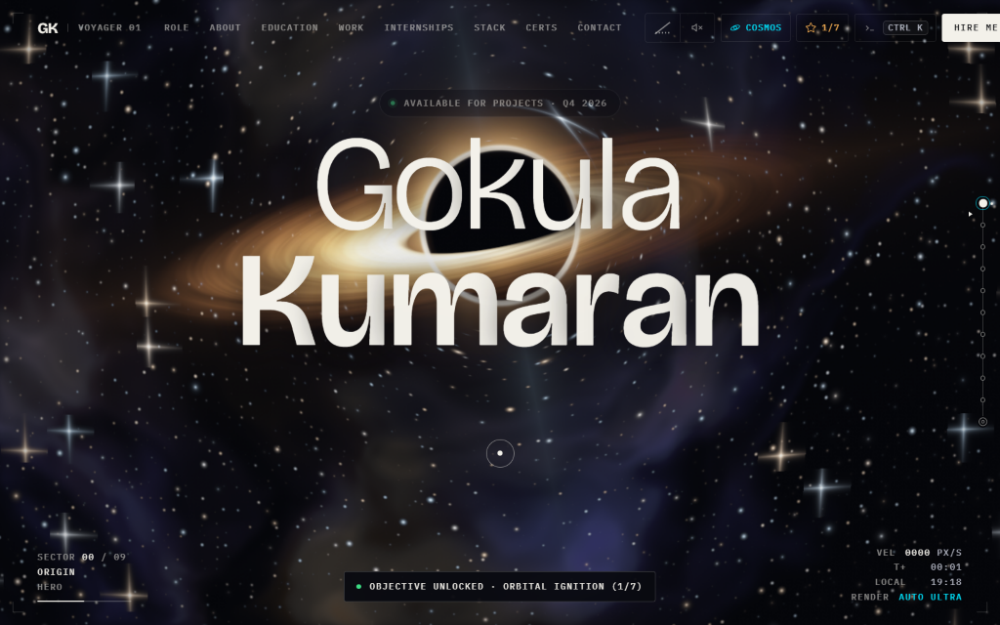
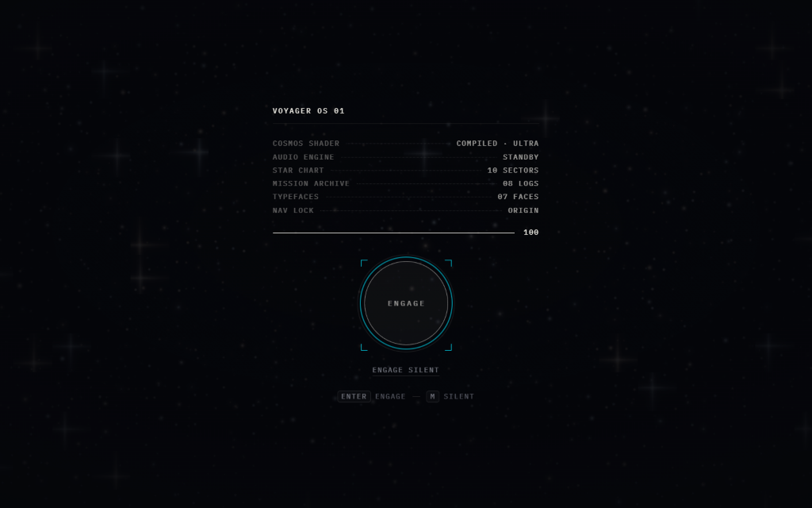
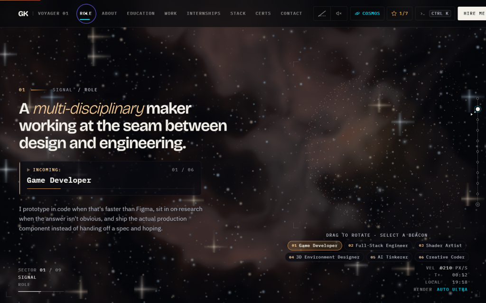
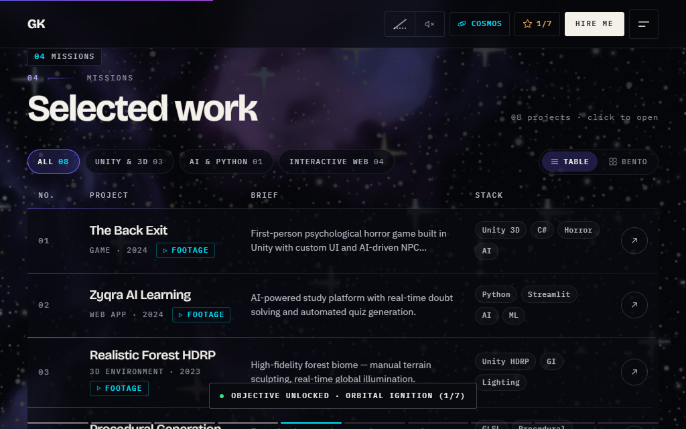
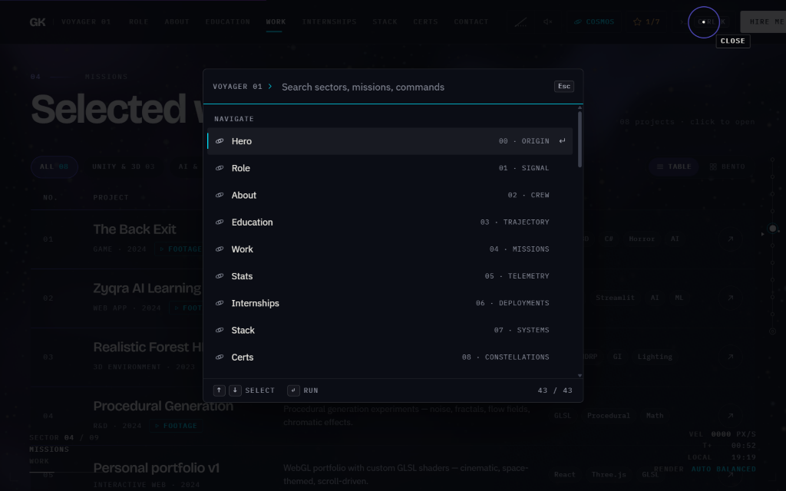
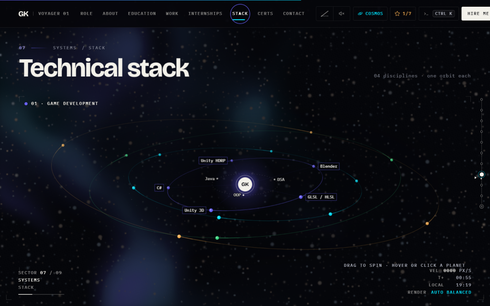
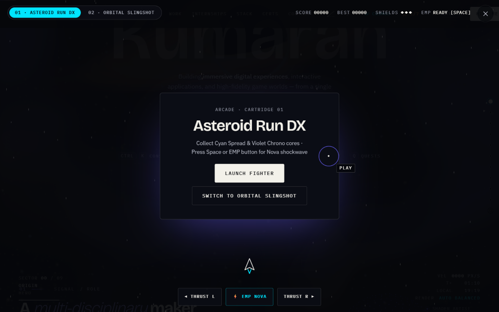

# Gokula Kumaran — Voyager 01 Interactive Space Portfolio (v4.1)

> **"A portfolio you fly through."**  
> A modular, zero-dependency sci-fi space voyage built in pure vanilla HTML5, CSS3, WebGL1 GLSL, and the Web Audio API—featuring a single-pass relativistic Kerr black hole shader, a real-time generative space music synthesizer, 10 interactive sectors, 7 discoverable field anomalies, and a dual-cartridge arcade deck.  
> 🌐 **Live Production Site**: [https://gokulakumarans.pages.dev/](https://gokulakumarans.pages.dev/)  
> 🐙 **GitHub Repository**: [https://github.com/sGokulaKumaran/portfolio-4.1](https://github.com/sGokulaKumaran/portfolio-4.1)



---

## 📚 Modular Documentation Hub

Because **Portfolio 4.1 (Voyager 01)** contains 13 custom JavaScript engines, 8 layered CSS stylesheets, custom 3D-on-2D mathematical projections, a WebGL fragment shader, and a full Web Audio DSP graph, its documentation is organized into dedicated guides:

| Document | What It Covers |
| :--- | :--- |
| 📄 **[`README.md`](README.md)** *(You are here)* | Visual screenshot tour, the 10 sectors, quick-reference mechanisms, keyboard controls & local setup |
| 🗂️ **[`docs/STRUCTURE.md`](docs/STRUCTURE.md)** | Complete directory tree, deterministic 13-script execution pipeline (`core` → `boot`), HTML `@region` boundaries, CSS z-index stack & 2-tier image pipeline |
| 🧠 **[`docs/CONCEPTS.md`](docs/CONCEPTS.md)** | Mathematical & engineering deep-dives: GLSL Kerr Black Hole lensing & FBM nebulae, Adaptive Frame-Time Governor, Web Audio algorithmic reverb & scale quantization, 3D Fibonacci Holo-Planet projection, exponential damping & N-Body gravity |
| ⚙️ **[`docs/MECHANISMS.md`](docs/MECHANISMS.md)** | Function-by-function & feature guide: `window.GK` runtime API, single-`rAF` ticker, `GK.bus` events, declarative `data-*` FX attributes, sector widgets, Ship Console (`VOYAGER 01>`) & Dual Arcade Deck |
| 📐 **[`ARCHITECTURE.md`](ARCHITECTURE.md)** | Internal module contract, state shapes, event signatures & design ground rules |

---

## 🖼️ Visual Gallery & Interactive Highlights

### 1. Voyager OS 01 Launch Sequence & Sector 00 Origin
A live diagnostic boot sequence compiles the WebGL cosmos shader, verifies the 10-sector star chart, and presents **`ENGAGE`** (unlocking real-time synthesized space music) before revealing the relativistic Kerr black hole in Sector 00.

| Voyager OS 01 Boot Sequence (`#loader`) | Sector 00 · Origin & Kerr Black Hole (`#p0`) |
| :---: | :---: |
|  |  |

### 2. Sector 01 Signal (3D Holo-Planet) & Sector 04 Missions
In **Sector 01**, visitors rotate a 3D Fibonacci particle globe with great-circle telemetry packets or click role beacons (`01 Game Developer` .. `06 Creative Coder`) to steer the planet. In **Sector 04**, projects can be filtered by stack and viewed in either a cursor-preview **Table View** or **Bento Grid View**.

| Sector 01 · Signal 3D Holo-Planet (`#p1`) | Sector 04 · Missions Selected Work (`#p3`) |
| :---: | :---: |
|  |  |

### 3. Ship Command Console (`VOYAGER 01>`) & Sector 07 Systems Orrery
Pressing `Ctrl+K` (or `/`) opens the fuzzy-searchable **Ship Console (`VOYAGER 01>`)** to jump across sectors, inspect mission briefings, switch shader modes, or launch hidden rooms. **Sector 07** maps technical disciplines as a draggable multi-orbit planetary **Skill Orrery**.

| Ship Command Console (`VOYAGER 01>`) | Sector 07 · Systems Skill Orrery (`#p4`) |
| :---: | :---: |
|  |  |

### 4. The Dual Arcade Deck (`Asteroid Run DX` & `Orbital Slingshot`)
Pressing `G` launches the built-in **Voyager Arcade Deck** featuring two complete HTML5 Canvas games: **Cartridge 01: Asteroid Run DX** (wave shooter with dreadnought bosses, EMP Nova shockwave, and spread/chrono cores) and **Cartridge 02: Orbital Slingshot** (real N-body gravitational slingshot golf with live $\Delta v$ predictive trajectory plotting).



---

## 🪐 The 10 Sectors of the Voyage (`GK.SECTORS`)

Every section of the portfolio is a spatial sector (`<section class="panel" data-sector="N">`) with its own dual-accent color palette (`--sector-a`, `--sector-b`) and musical key that cross-fade smoothly as you fly through the page:

| Sector | ID | In-Fiction Name | Nav Label | Interactive Mechanism | Owner Module |
| :---: | :--- | :--- | :--- | :--- | :--- |
| **00** | `#p0` | **Origin** | Hero | Variable weight-wave typography + Kerr Black Hole **Singularity Shockwave** trigger | `voyage-a.js` |
| **01** | `#p1` | **Signal** | Role | Draggable **3D Holo-Planet** (`#roleCanvas`) with 6 auto-steering role beacons & Slerp packet arcs | `voyage-a.js` |
| **02** | `#p2` | **Crew** | About | **Biometric X-Ray Dossier Lens** (`0% → 100% CLEARANCE VERIFIED`) + interactive loadout chips | `voyage-b.js` |
| **03** | `#p2-edu` | **Trajectory** | Education | Scroll-driven **SVG S-Curve Flight Path** (`#eduSvg`) with igniting school & college waypoints | `voyage-b.js` |
| **04** | `#p3` | **Missions** | Work | Category filter + **Table / Bento Grid switcher** + cursor-following thumbnail preview + Video Briefing Modal | `voyage-c.js` |
| **05** | `#p3-5` | **Telemetry** | Stats | 4 radial SVG arc gauges synced with exponential `data-count` counters | `voyage-c.js` |
| **06** | `#p3-intern` | **Deployments** | Internships | Interactive deployment logs (*Skiez Digital* & *Playxoft Studios*) with certificate modal inspection | `voyage-c.js` |
| **07** | `#p4` | **Systems** | Stack | Interactive **4-Orbit Skill Orrery** (`#sysCanvas`) with draggable rotation, planet pinning & Lagrange dust | `voyage-d.js` |
| **08** | `#p5` | **Constellations** | Certs | Playable **6-Star Musical Constellation Sky** (`#certSky`) — ring all 6 stars to summon a meteor shower | `voyage-d.js` |
| **09** | `#p6` | **Transmission** | Contact | Interactive service chip selector, 1-click sample message prefill, clipboard copy & `mailto:` transmitter | `voyage-d.js` |
| **∞** | `#wormhole` | **Event Horizon** | Loop | Scrolling past Sector 09 bends spacetime and warps the visitor right back to **Sector 00 · Origin** | `flow.js` |

---

## ⚡ Quick-Reference: Key Methods & Architectural Mechanisms

> *For full mathematical derivations and function breakdowns, see **[`docs/CONCEPTS.md`](docs/CONCEPTS.md)** and **[`docs/MECHANISMS.md`](docs/MECHANISMS.md)**.*

- **Zero Framework, `file://` Ready**: Built with classic IIFE scripts registering via `GK.register(name, initFn)` in deterministic order (`core` → `data` → `fx` → `audio` → `cosmos` → `hud` → `flow` → `voyage-a..d` → `extras` → `boot`). Works immediately by double-clicking `index.html` or hosting on any static server.
- **Single `requestAnimationFrame` Loop (`GK.ticker.add`)**: All animations—scroll velocity, pointer damping, 3D Holo-Planet, Skill Orrery, Constellations, Arcade physics, and the WebGL cosmos shader—run inside one prioritized `rAF` loop.
- **Zero-Cost Offscreen Canvases (`GK.util.onVisible`)**: Pooled `IntersectionObserver` instances automatically pause any 2D canvas loop as soon as its sector leaves the viewport (`.is-offstage`).
- **Closed-Loop Performance Governor (`GK.perf`)**: Continuously monitors frame delta times (`EMA`) across 4 render tiers (`0 Eco` → `1 Balanced` → `2 High` → `3 Ultra`), down-stepping resolution immediately on frame spikes and pacing down to 30 FPS after 8 seconds of user inactivity.
- **Declarative FX Engine (`fx.js` & `GK.scan`)**: HTML elements opt into complex animations simply via attributes: `data-reveal`, `data-reveal-group`, `data-split="chars|words"`, `data-decode`, `data-count`, `data-tilt`, `data-magnetic`, `data-spot`, `data-parallax`, and `data-cursor-lock`.

---

## 🎯 Explorer Field Objectives (`OBJ-01` – `OBJ-07`)

Press **`Q`** (or click the `☆ 0/7` button in the header) to open `// voyager_field_objectives.log`. Discovering all 7 interactive anomalies across the voyage unlocks the **Master Voyager Supernova Meteor Shower**:

1. **`OBJ-01` · Orbital Ignition** *(Sector 00 · Origin)*: Engage the ship systems from the launch sequence.
2. **`OBJ-02` · Singularity Grazer** *(Sector 00 · Origin)*: Double-click or press the Singularity Pulse button near the Hero Black Hole to trigger a relativistic spacetime ripple.
3. **`OBJ-03` · Signal Triangulation** *(Sector 01 · Signal)*: Lock onto 3 different role beacons on the interactive 3D Holo-Planet.
4. **`OBJ-04` · Biometric Clearance** *(Sector 02 · Crew)*: Scan the Crew Dossier portrait with the X-Ray lens to 100% quantum clearance.
5. **`OBJ-05` · Harmonic Constellation** *(Sector 08 · Constellations)*: Ring all 6 certificate stars in the Constellations sky to summon a meteor shower.
6. **`OBJ-06` · Beyond Charted Space** *(Sector 09 → 00 · Wormhole)*: Traverse the closing Wormhole at the end of the voyage back to Origin.
7. **`OBJ-07` · Void Ace Pilot** *(Arcade Deck)*: Score 400+ in *Asteroid Run DX* or clear a level in *Orbital Slingshot*.

---

## ⌨️ Keyboard Shortcuts & Ship Controls

| Key / Gesture | Action |
| :--- | :--- |
| `Enter` / `M` *(on Loader)* | Engage with full Web Audio synthesis (`Enter`) or Engage Silent (`M`) |
| `Ctrl + K` / `⌘ + K` / `/` | Toggle the **Ship Command Console (`VOYAGER 01>`)** |
| `M` | Toggle generative ambient space music on/off |
| `G` | Launch the **Voyager Dual Arcade Deck** (*Asteroid Run DX* & *Orbital Slingshot*) |
| `Q` | Open the **Explorer Field Objectives (`0 / 7`)** log |
| `↑` / `↓` or `J` / `K` | Travel one sector up or down (scrolls normally inside tall sectors first) |
| `Esc` | Close the top-most active modal, console, or overlay layer |
| `↑ ↑ ↓ ↓ ← → ← → B A` | Konami Code — unlock the hidden **Secret Bridge Panel** |

---

## 🚀 Running Locally

Because Voyager 01 is engineered without build tools or external runtime dependencies, no `npm install` is needed:

1. **Direct Launch (`file://`)**:
   Simply double-click [`index.html`](index.html) in File Explorer / Finder to open it directly in Chrome, Edge, Firefox, or Safari.
2. **Local Static Server (Optional)**:
   ```bash
   # Python 3
   python -m http.server 8080

   # Then visit http://localhost:8080
   ```

---

## 👤 Author

**Gokula Kumaran S**  
*Game & Full-Stack Developer — Tamil Nadu, India (`11.1271° N · 78.6569° E`)*  
- **Live Portfolio (v4.1)**: [https://gokulakumarans.pages.dev/](https://gokulakumarans.pages.dev/)
- **Portfolio Repository**: [sGokulaKumaran/portfolio-4.1](https://github.com/sGokulaKumaran/portfolio-4.1)
- **GitHub**: [@sGokulaKumaran](https://github.com/sGokulaKumaran)
- **LinkedIn**: [gokula-kumaran-s](https://www.linkedin.com/in/gokula-kumaran-s-503545328/)
- **Instagram**: [@goku_1._38](https://www.instagram.com/goku_1._38)
- **Email**: [gokulakumaran2007@gmail.com](mailto:gokulakumaran2007@gmail.com)
