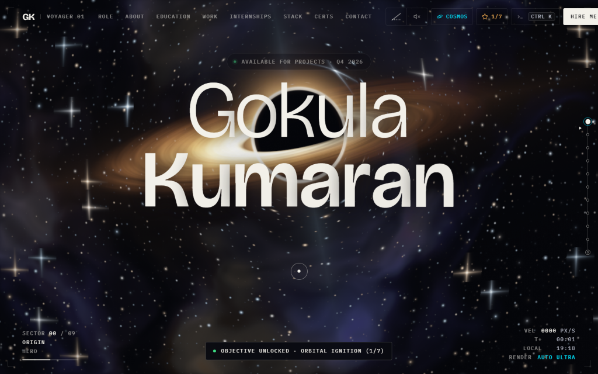
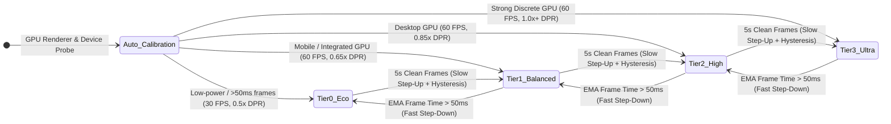
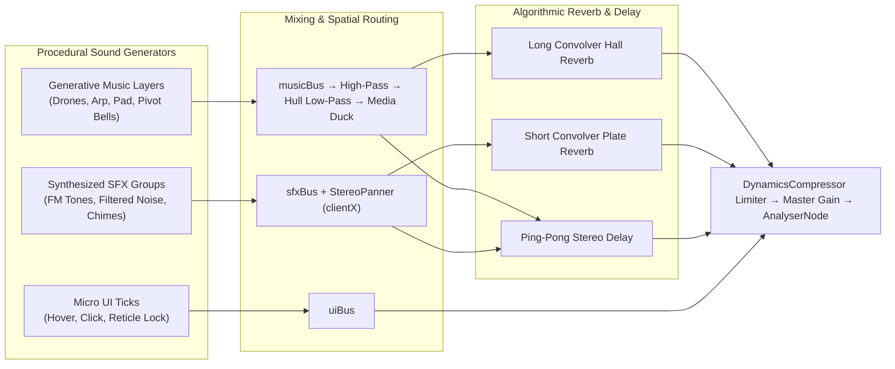
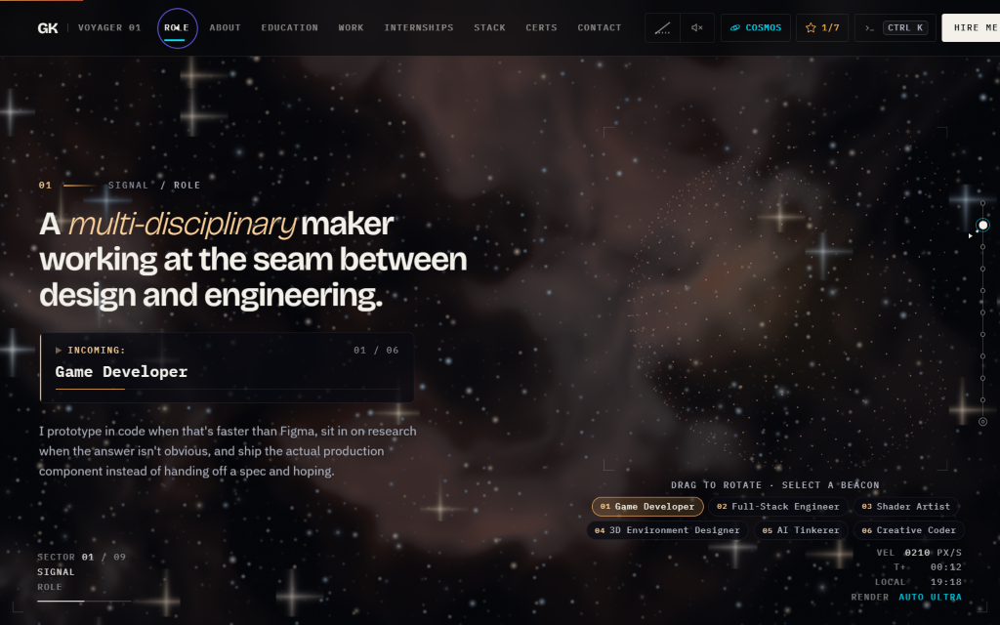

# Voyager 01 (Portfolio 4.1) — Engineering & Mathematical Concepts

> **A deep-dive into the computer graphics, digital signal processing (DSP), 3D projection mathematics, orbital physics, and real-time systems engineering that power Voyager 01 without a single external library.**

📚 **Documentation Navigation**:
- [← Back to Main README](../README.md)
- [File & Project Structure (`docs/STRUCTURE.md`)](STRUCTURE.md)
- [Interactive Mechanisms, Functions & Methods (`docs/MECHANISMS.md`)](MECHANISMS.md)
- [Internal Module Contract (`ARCHITECTURE.md`)](../ARCHITECTURE.md)

---

## 1. Single-Pass WebGL1 Relativistic Cosmos Shader (`js/cosmos.js`)

The permanent backdrop (`<canvas id="cosmos">`) is a **procedural single-pass GLSL ES 1.00 fragment shader** rendered across a full-screen quad (`[-1, 1]`). Every celestial phenomenon is evaluated mathematically per pixel at up to 60+ FPS.



### Key Shader Concepts

1. **Gravitational Lensing & Kerr Black Hole (`uBH`)**:
   - Models an inclined relativistic accretion disk and photon sphere around the Sector 00 Origin singularity.
   - **Coordinate Warping**: Rays passing near the Schwarzschild radius $r_s$ bend via an inverse-distance deflection field:
     $$\vec{p}' = \vec{p} \cdot \left(1 - \frac{r_s^2}{\|\vec{p}\|^2}\right)$$
   - **Relativistic Doppler Beaming**: Matter orbiting on the approaching side of the disk is brightened and blue-shifted toward warm white-gold, while the receding side is dimmed and red-shifted.
   - **Relativistic Polar Jets & Shockwaves**: Computes bipolar plasma jets perpendicular to the accretion plane and radial spacetime ripple distortion (`uPulse`) when the user triggers a Singularity Shockwave.

2. **Fractional Brownian Motion (FBM) Ionized Nebulae (`fbm` & `vn`)**:
   - Uses 2D value noise (`vn`) summed across multiple octaves with domain warping to synthesize volumetric cosmic dust clouds and ionized emission ridges.
   - **Live Sector Palette Cross-Fading**: The shader receives `uColA` and `uColB` (`vec3` RGB uniforms interpolated continuously by `core.js` as the user scrolls across sectors `0..9`), shifting nebula hues seamlessly from Origin Violet/Amber to Signal Cyan, Missions Indigo, and Systems Emerald.

3. **Multi-Layer Parallax Starfield & Spectral Diffraction Flares**:
   - Evaluates hashed grid cells at multiple depth scales (`starLayer`).
   - Bright anchor stars receive 4-point optical diffraction spikes (`exp(-abs(d.x)*w) * exp(-abs(d.y)*s)`) and subtle chromatic temperature variation.
   - **Hyperspace Warp Streaking (`uWarp`)**: During a multi-sector jump or high-velocity scroll, star samples elongate radially along the velocity vector to simulate relativistic star streaking.

4. **Procedural Planetary Bodies (Gas Giant, Ring System & Solar Rise)**:
   - As the visitor travels through middle and late sectors, the shader analytically ray-intersects a banded gas giant with an inclined planetary ring system, an orbiting moon casting a soft penumbra, and a lower-horizon solar corona (`uSun`) with atmospheric Rayleigh-like rim glow.

5. **Interleaved Gradient Noise Dithering**:
   - To prevent 8-bit color banding across subtle dark-space gradients (`#05060A`), the final fragment color adds a 2-channel Jimenez Interleaved Gradient Noise dither before output:
     ```glsl
     float n1 = fract(52.9829189 * fract(dot(gl_FragCoord.xy, vec2(0.06711056, 0.00583715))));
     ```

---

## 2. Adaptive Frame-Time Performance Governor (`GK.perf` & `cosmos.js`)

Because WebGL fragment shaders are fill-rate bound (cost scales with `width × height × devicePixelRatio²`), Voyager 01 implements an automatic closed-loop **Frame-Time Governor** so both integrated laptop GPUs and high-end desktops stay locked at smooth frame rates.



### How the Governor Works
- **Hardware Heuristic Probe (`GK.env.gpu`)**: Inspects `WEBGL_debug_renderer_info` (`UNMASKED_RENDERER_WEBGL`), `navigator.hardwareConcurrency`, `navigator.deviceMemory`, and touch capabilities at boot to pick a safe starting tier (`0 Eco`, `1 Balanced`, `2 High`, `3 Ultra`).
- **Exponential Moving Average (EMA) Telemetry**: Tracks frame delta times (`gov.ema`).
  - **Asymmetric Response**: If sustained frames exceed `~50ms` (<20 FPS), the governor **steps down immediately** to protect scroll responsiveness. Stepping **up** requires **5.0 seconds of consecutive clean frames**, and if an upgrade immediately fails, a hysteresis lockout timer doubles to prevent oscillation.
- **8-Second Idle Power Saver**: After 8 seconds without pointer, scroll, or keyboard activity on Balanced/Eco/touch devices, canvas redraws automatically pace down to 30 FPS (`perf.idleGap()`), waking instantaneously on the next user input.

---

## 3. Zero-Sample Generative Web Audio Synthesizer (`js/audio.js`)

Voyager 01 loads **zero `.mp3`, `.ogg`, or `.wav` files** for its music and UI sound effects. The entire soundtrack and 22+ interactive sound effects are synthesized in real time using the browser's native **Web Audio API** DSP graph.



### DSP & Musical Concepts
1. **Algorithmic Impulse Response (IR) Convolver Reverb**:
   - At audio initialization, `audio.js` mathematically generates stereo exponentially decaying white/pink-noise buffers in memory and loads them into two `ConvolverNode` instances: a **long cosmic hall** for ambient music and a **short metallic plate** for UI/game SFX.
2. **Sector-Aware Harmonic Key Modulation**:
   - Each of the 10 sectors defines a musical root, scale mode, and harmonic tension (`H`).
   - When the visitor travels from Sector 00 (*Origin*) to Sector 04 (*Missions*) or Sector 08 (*Constellations*), the generative score cross-fades voices and pivots keys smoothly. Even UI sound effects (`GK.sfx('chime', { i })`) quantize their frequencies (`K(degree, octave)`) to the active sector's musical scale so clicks and star rings always harmonize with the background score.
3. **Spatial Stereo Panning**:
   - Passing `{ x: event.clientX }` to `GK.sfx(name, opts)` maps the horizontal screen coordinate `[0, window.innerWidth]` to a `StereoPannerNode` value in `[-0.7, +0.7]`, giving every button click, constellation star, and asteroid explosion true left-to-right spatial placement.
4. **Real-Time FFT Spectrum Extraction (`GK.state.audio`)**:
   - An `AnalyserNode` taps the master bus on every animation frame, decomposing frequency bins into smoothed `level`, `bass`, `mid`, and `high` (`0..1`) metrics that drive the header audio visualizer and subtly pulse the WebGL cosmos shader.

---

## 4. 3D Spherical Projection on 2D Canvas (`js/voyage-a.js`)

In **Sector 01 · Signal**, the interactive **3D Holo-Planet** (`<canvas id="roleCanvas">`) renders a 3D globe with Fibonacci-distributed surface particles, latitude/longitude rings, an equatorial satellite belt, 6 surface role beacons, and animated great-circle telemetry packets—all using pure 3D trigonometry on a lightweight 2D Canvas context.



### Mathematical Pipeline
1. **Fibonacci Sphere Lattice**:
   - Distributes $N$ points evenly across a unit sphere using the Golden Angle $\phi = \pi(3 - \sqrt{5})$:
     $$y_i = 1 - \frac{2i}{N - 1}, \quad r_i = \sqrt{1 - y_i^2}, \quad \theta_i = i \cdot \phi$$
     $$(x_i, y_i, z_i) = (r_i \cos\theta_i,\; y_i,\; r_i \sin\theta_i)$$
2. **3D Rotation Matrix & Orthographic Projection**:
   - Every point $(x, y, z)$ is rotated by yaw ($\alpha$) and pitch ($\beta$) angles:
     $$x_1 = x\cos\alpha + z\sin\alpha, \quad z_1 = z\cos\alpha - x\sin\alpha$$
     $$y_2 = y\cos\beta - z_1\sin\beta, \quad z_2 = z_1\cos\beta + y\sin\beta$$
   - The depth coordinate $z_2 \in [-1, 1]$ drives **backface culling / depth fog** (points on the far hemisphere $z_2 < 0$ dim and shrink), while $(x_1, y_2)$ projects directly onto screen pixels $(cx + R \cdot x_1,\; cy + R \cdot y_2)$.
3. **Auto-Steering to Selected Role Beacons**:
   - When the user clicks a role pill (`01 Game Developer` .. `06 Creative Coder`), the planet computes the target yaw and pitch required to bring that beacon's 3D normal vector to the front-facing hemisphere ($z_2 > 0$) and smoothly damps toward it.
4. **Slerp Great-Circle Telemetry Packets**:
   - Animated data packets travel between beacons along the curved surface of the sphere using **Spherical Linear Interpolation (Slerp)** so arcs hug the globe's curvature rather than clipping through its interior.

---

## 5. Frame-Rate Independent Exponential Damping (`js/core.js`)

Standard linear interpolation (`x += (target - x) * 0.1`) runs twice as fast on a 120Hz display as on a 60Hz display. Voyager 01 uses **time-corrected exponential decay** (`GK.util.damp`) across all physics, cursor tracking, camera parallax, and scroll velocity smoothing:

```javascript
const damp = (a, b, lambda, dt) => a + (b - a) * (1 - Math.exp(-lambda * dt));
```

- **`a`**: Current value
- **`b`**: Target value
- **`lambda` ($\lambda$)**: Stiffness / responsiveness constant (higher = snappier)
- **`dt`**: Elapsed frame time in seconds (clamped to `≤ 0.05s` to prevent jumps after tab-switching)

Because $1 - e^{-\lambda \cdot \Delta t}$ integrates the continuous differential equation $\frac{dx}{dt} = \lambda(b - x)$ exactly, animations feel identical on 60Hz, 120Hz ProMotion, and 240Hz gaming monitors.

---

## 6. N-Body Gravitational Mechanics in Orbital Slingshot (`js/extras.js`)

Cartridge 02 of the Dual Arcade Deck (**Orbital Slingshot**) implements a real **multi-body gravitational physics simulation** ("gravity golf"):

1. **Inverse-Square Gravitational Summation**:
   - On each physics substep, the probe at position $\vec{p}$ experiences net gravitational acceleration from all planetary hazards $i \in \{1..k\}$:
     $$\vec{a}(\vec{p}) = \sum_{i=1}^{k} \frac{G \cdot M_i}{\left(\|\vec{r}_i\|^2 + \epsilon^2\right)} \cdot \frac{\vec{r}_i}{\|\vec{r}_i\|}, \quad \text{where } \vec{r}_i = \vec{c}_i - \vec{p}$$
   - Here $\epsilon$ is a softening constant that prevents infinite acceleration singularities at planet centers.
2. **Predictive Trajectory Lookahead**:
   - While the player drags back the slingshot launch vector, the engine runs a **forward Euler / Verlet integration loop** over $N$ virtual future timesteps using the exact same gravity field, rendering a dotted predictive orbital curve and a live $\Delta v$ velocity readout before launch.
