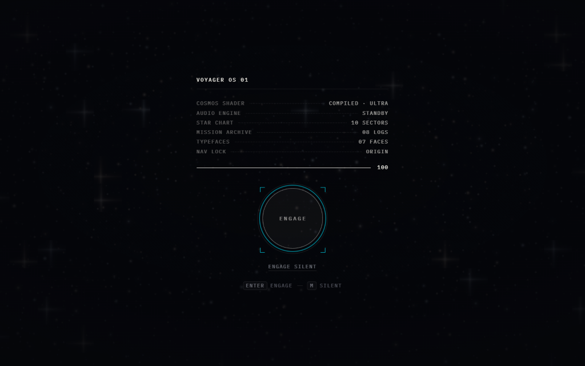
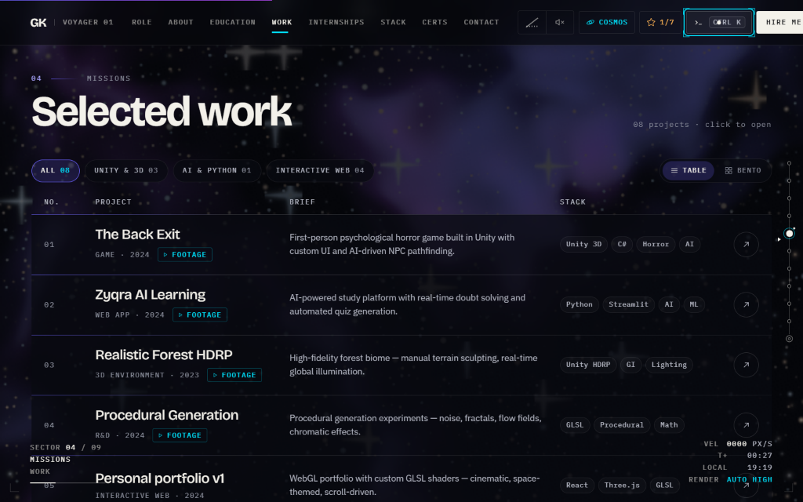
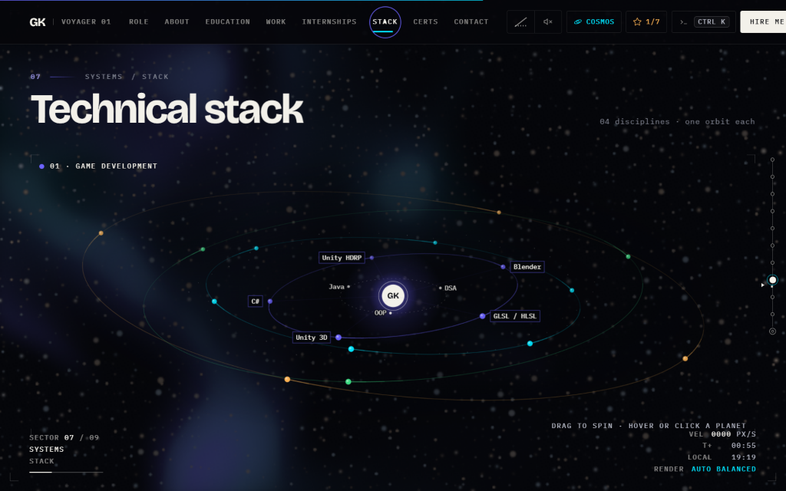
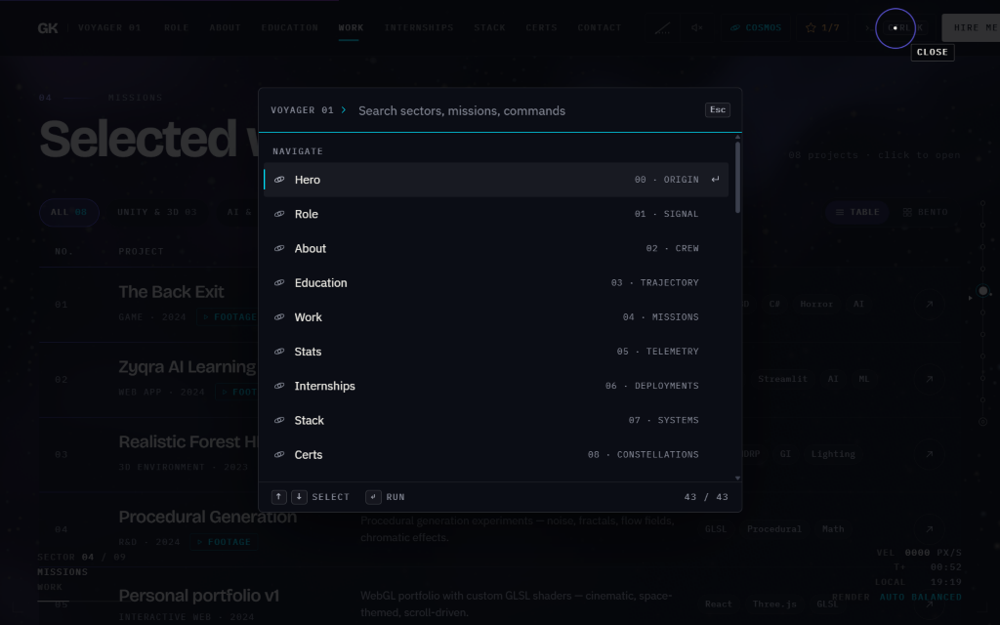
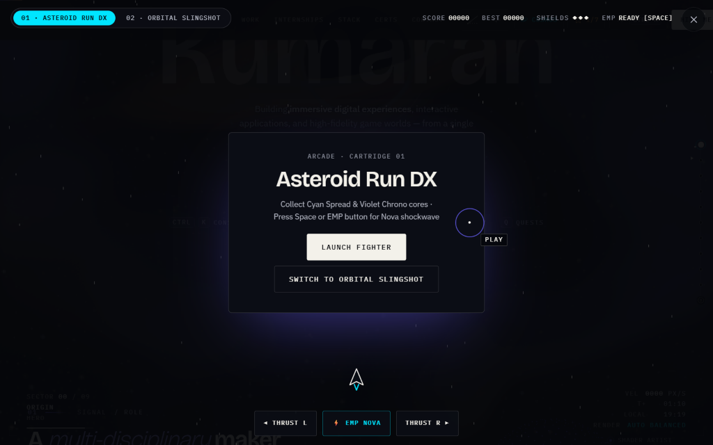

# Voyager 01 (Portfolio 4.1) — Interactive Mechanisms, Functions & Methods Guide

> **A complete engineering reference explaining how every interactive mechanism, runtime API method, declarative FX attribute, sector widget, and hidden room works in Voyager 01.**

📚 **Documentation Navigation**:
- [← Back to Main README](../README.md)
- [File & Project Structure (`docs/STRUCTURE.md`)](STRUCTURE.md)
- [Engineering & Mathematical Concepts (`docs/CONCEPTS.md`)](CONCEPTS.md)
- [Internal Module Contract (`ARCHITECTURE.md`)](../ARCHITECTURE.md)

---

## 1. Core Runtime Engine (`js/core.js` & `js/boot.js`)

All 13 modules share a single global namespace (`window.GK`) initialized by `core.js`.

### Key Mechanisms & Methods

| Method / Object | Signature | Mechanism & Responsibility |
| :--- | :--- | :--- |
| **`GK.ticker.add`** | `GK.ticker.add(fn(state, dt), order = 10) → removeFn` | **Single `requestAnimationFrame` Loop**: The entire application uses only **one** `rAF` loop. Tasks are sorted by `order` (core scroll & pointer measurement runs first at `order < 0`, sector canvases at `10`, cosmos shader draw at the end). Automatically pauses when the browser tab is hidden (`document.hidden`). |
| **`GK.bus`** | `.on(evt, fn)`, `.once(evt, fn)`, `.off(evt, fn)`, `.emit(evt, data)` | **Decoupled Pub/Sub Event Bus**: Modules never import or directly mutate each other. For example, pressing `ENGAGE` in `hud.js` emits `bus.emit('enter', { sound: true })`, which triggers `audio.js` to unlock `AudioContext`, `fx.js` to start scroll reveals, and `cosmos.js` to animate the black hole intro. |
| **`GK.scroll`** | `.measure()`, `.teleport(y)`, `.topOf(indexOrId)`, `.indexOf(idOrKey)` | **Zero-Thrash Layout Cache**: Measures every `.panel` sector's top offset and height once (and on window `resize` / `measure` events) rather than calling `getBoundingClientRect()` every frame. Computes continuous sector progress `GK.state.sectorF` (`0.00` to `9.00`) and live scroll velocity (`px/s`). |
| **`GK.warp`** | `GK.warp(strength = 1, durationMs = 900)` | **Hyperspace Envelope Generator**: Drives `GK.state.warp` (`0..1`) along a bell-curve attack/decay envelope, toggles `html.is-warping`, and emits `warp:start` / `warp:end` so the WebGL shader stretches stars into hyperspace streaks. |
| **`GK.util.onVisible`** | `onVisible(el, cb(visible), opts) → stopFn` | **Pooled IntersectionObserver Gate**: Pools observers by option signature. Every 2D canvas sector (Holo-Planet, Trajectory, Orrery, Constellations) wraps its ticker callback with `onVisible` so **off-screen sectors consume 0% CPU/GPU**. |
| **`GK.store`** | `.get(key, fallback)`, `.set(key, value)` | **Fault-Tolerant Persistence**: Wraps `localStorage` in `try/catch` blocks (safe in Private Browsing / sandboxed iframes) to persist pinned performance tiers, discovered Explorer Quests, and Arcade high scores. |
| **`GK.boot`** | `GK.boot()` (in `boot.js`) | Executes all registered `GK.register(name, initFn)` modules once the DOM is ready, backed by a **2,500ms Fail-Safe Watchdog** that automatically removes `#loader` and emits `enter` if the HUD ever fails to arm. |

---

## 2. Declarative FX Primitives (`js/fx.js`)

Rather than writing repetitive scroll/pointer scripts for every card and heading, `fx.js` scans the DOM (`GK.scan(root)`) and binds interactive behaviors via HTML `data-*` attributes:

| HTML Attribute | Mechanism & Implementation Details |
| :--- | :--- |
| `data-reveal="up\|fade\|left\|right\|scale\|blur"` | Waits until `GK.state.entered === true` (after `ENGAGE`), then adds `.is-in` when scrolled into view (`data-delay="ms"` adds staggered timing). |
| `data-reveal-group="80"` | Automatically staggers direct children by `80ms` increments when the parent container enters the viewport. |
| `data-split="chars\|words"` | Splits text nodes into masked `` / `` wrappers for staggered vertical rise while preserving screen-reader accessibility via `aria-label`. |
| `data-decode` | **Sci-Fi Cipher Scramble**: When revealed, cycles characters through a glyph pool (`◇◈▣░▒▓╱╲`) before resolving left-to-right into the final label. |
| `data-count="8"` `data-suffix="+"` | Smoothly counts numeric metrics from `0` to target value using an `easeOutExpo` curve upon reveal. |
| `data-tilt="8"` | **3D Card Perspective Tilt**: Tracks pointer offsets inside the card's cached bounding box, smoothly damping `rotateX` and `rotateY` up to `±8°` and writing `--mx` / `--my` CSS variables for radial specular glare. |
| `data-magnetic="0.28"` | **Magnetic Button Attraction**: Pulls buttons toward the cursor by `28%` of the pointer displacement from the element's center, snapping smoothly back on `pointerleave`. |
| `data-spot` | Tracks local pointer coordinates `--mx` and `--my` (in `px`) inside an element to position a CSS radial spotlight border/background glow. |
| `data-parallax="0.15"` | Applies a vertical scroll drift offset via CSS `translate` proportional to the element's distance from the viewport center. |

---

## 3. Ship Chrome & HUD Telemetry (`js/hud.js`)

1. **Voyager OS 01 Launch Sequence (`#loader`)**:
   - Steps through a real diagnostic verification checklist (`COSMOS SHADER`, `AUDIO ENGINE`, `STAR CHART`, `MISSION ARCHIVE`, `TYPEFACES`, `NAV LOCK`) while incrementing `#loaderBar` and `#loaderPct` from `000` to `100`.
   - Presents two launch gestures: **`ENGAGE`** (unlocks Web Audio synthesizer + starts ambient space score) and **`ENGAGE SILENT`** (enters muted; keyboard shortcuts `Enter` or `M`).
2. **Targeting Reticle Cursor (`#reticle`)**:
   - Active on fine pointers (`hover: hover`). Renders a central dot, a damped outer ring, 4 corner lock-on brackets (`.rc-tl`, `.rc-tr`, `.rc-bl`, `.rc-br`), and a contextual `.reticle-label`.
   - Hovering any element with `data-cursor="OPEN"` displays the label chip; hovering `data-cursor-lock` snaps the 4 corner brackets tightly around the target element's bounding box.
3. **Header Bar & Live Audio Spectrum (`#siteHeader`)**:
   - Features an animated active-link underline (`#navBar`), a 4-bar real-time frequency visualizer (`#musicBtn`) driven by `GK.audio.spectrum()`, a Cosmos Visual Mode cycler (`#cosmosModeBtn`: *Standard Cosmos* → *Nebula Overdrive* → *Hyper-Singularity*), and the Explorer Quests counter (`#questsBtn`).
4. **Honest Corner HUD Instruments & Orbit Map (`#orbitMap`)**:
   - **Bottom-Left HUD**: Displays active sector index (`00 / 09`), in-fiction sector name (`ORIGIN`), nav label (`HERO`), and intra-sector scroll progress bar (`#hudSectorBar`).
   - **Bottom-Right HUD**: Displays real scroll velocity (`VEL 0000 PX/S`), mission elapsed timer since `ENGAGE` (`T+ 00:00`), visitor's local 24h clock (`LOCAL`), and clickable Render Tier badge (`AUTO ULTRA` / `HIGH` / `BALANCED` / `ECO`).
   - **Right-Hand Orbit Map (`#orbitMap`)**: 10 sector nodes + wormhole loop indicator for single-click sector jumping.

---

## 4. Sector-by-Sector Interactive Mechanisms (`voyage-a.js` – `voyage-d.js`)

### Sectors 00 & 01 — `js/voyage-a.js`
- **Sector 00 · Origin (`initHero`)**:
  - **Variable Weight-Wave Typography**: Each character of `Gokula Kumaran` responds to pointer proximity and a continuous sine wave by modulating font weight and subtle vertical lift.
  - **Singularity Shockwave (`#heroShockBtn` & double-click gesture)**: Emits a gravitational pulse (`GK.cosmos.flash`) that ripples the WebGL Kerr black hole and unlocks Explorer Objective **`OBJ-02`** (*Singularity Grazer*).
- **Sector 01 · Signal (`initSignal`)**:
  - **Interactive 3D Holo-Planet (`#roleCanvas`)**: Drag to rotate the 3D particle sphere in any direction, or click any of the 6 role beacons (`01 Game Developer` .. `06 Creative Coder`) to auto-steer the globe, decode role telemetry, and unlock **`OBJ-03`** (*Signal Triangulation*) after locking onto 3 beacons.

### Sectors 02 & 03 — `js/voyage-b.js`
- **Sector 02 · Crew (`initCrew`)**:
  - **Biometric X-Ray Scanner Lens (`#aboutDossier`)**: Hovering or dragging across the developer portrait moves a circular X-Ray clipping mask over an inverted wireframe/blueprint layer (`.dossier-xray`).
  - **Clearance Verification State Machine (`advanceScan`)**: Moving or clicking across the portrait increments scan progress from `SCANNING 00%` to `100%`, flipping the stamp to **`CLEARANCE VERIFIED`** (`.is-verified`), playing a confirmation chime, and unlocking **`OBJ-04`** (*Biometric Clearance*).
- **Sector 03 · Trajectory (`initTrajectory`)**:
  - **Scroll-Driven S-Curve Flight Path (`#eduSvg`)**: Dynamically computes a smooth cubic Bezier SVG path connecting the education cards (Higher Secondary School → Ramco Institute of Technology) and animates the glowing path stroke and waypoint nodes as the visitor scrolls through the sector.

### Sectors 04, 05 & 06 — `js/voyage-c.js`

- **Sector 04 · Missions (`initMissions`)**:
  - **Category Filtering & View Switcher**: Filter projects live across `All (08)`, `Unity & 3D (03)`, `AI & Python (01)`, and `Interactive Web (04)`, and toggle between **Table Rows View** and **Bento Grid View** (persisted in `GK.store`).
  - **Cursor-Following Floating Preview (`#workPreview`)**: In Table mode on fine pointers, hovering any project row smoothly glides a floating `16:10` thumbnail preview alongside the cursor using damped coordinates.
  - Clicking any project opens the full **Mission Briefing Modal (`GK.modal.open`)** with high-res imagery, tags, live links, and on-demand Cloudinary video streaming.
- **Sector 05 · Telemetry (`initTelemetry`)**:
  - Renders 4 radial SVG arc gauges (`6+ Certifications`, `8+ Projects shipped`, `2+ Internships`, `100% Dedication`) whose stroke-dashoffset animates synchronously with `data-count`.
- **Sector 06 · Deployments (`initDeployments`)**:
  - Interactive internship deployment logs (*Skiez Digital — Python Full-Stack* and *Playxoft Studios — Unity Game Development*) that open their verified certificate briefings on click.

### Sectors 07, 08 & 09 — `js/voyage-d.js`

- **Sector 07 · Systems (`initSystems`)**:
  - **Interactive Skill Orrery (`#sysCanvas`)**: A playable planetary system with `GK` at the core, surrounded by `Java · DSA · OOP` inner foundation bodies and **4 concentric discipline orbits** (*01 Game Development*, *02 Full-Stack Development*, *03 AI Development*, *04 Procedural Generation*), each carrying orbiting skill moons (`Unity 3D`, `C#`, `React`, `Three.js`, `Python`, `GLSL / HLSL`, etc.).
  - Visitors can **drag to spin** the orbital plane, hover or click any skill planet to pin its telemetry card, and inspect harmonic resonance vectors and Lagrange dust belts.
- **Sector 08 · Constellations (`initConstellations`)**:
  - **Playable Musical Star Sky (`#certSky`)**: Maps all 6 certifications as interactive stars connected by constellation filaments over a drift-animated star canvas.
  - Hovering or clicking each star plays an ascending harmonic scale note (`GK.sfx('chime', { i })`) and increments the live **Harmonic Star Counter (`0 / 6 Rung`)**. Ringing all 6 stars triggers a full-screen **Supernova Meteor Shower** (`GK.cosmos.shower(6.0)`) and unlocks **`OBJ-05`** (*Harmonic Constellation*).
- **Sector 09 · Transmission (`initTransmission`)**:
  - Interactive service chip selector (`Game Development`, `Full-Stack Web`, `AI Integration`, `Other`), 1-click sample message prefill (`#prefillBtn`), copyable email/phone chips with HUD toast confirmation, and a `mailto:` transmission composer.

---

## 5. Travel, Overlays & The Three Hidden Rooms (`js/flow.js` & `js/extras.js`)

### Programmatic Travel & The Ship Console (`flow.js`)

- **`GK.navTo(indexOrId, opts)`**:
  - **Adjacent Sector (`|to - from| <= 1`)**: Performs a smooth, user-cancellable cubic scroll tween (`easeInOutCubic`).
  - **Long-Range Jump (`|to - from| >= 2`)**: Engages a **Hyperspace Jump** (`GK.warp(1, 820)`), flashing the `#flash` veil at peak warp while teleporting directly to the target sector.
- **Ship Command Console (`GK.palette` · `Ctrl+K` or `/`)**:
  - Displays the **`VOYAGER 01>`** terminal prompt with instant fuzzy filtering across all 10 sectors, 8 project briefings, 6 certificates, 2 internships, audio controls, visual modes, and hidden room launchers.
- **Closing Wormhole Loop (`#wormhole`)**:
  - Scrolling past Sector 09 (*Transmission*) pulls the ship into the **Event Horizon (`09 → 00`)**. Continuing to scroll down (or clicking `Jump to Origin`) triggers a warp jump back to Sector 00 (`#p0`) and unlocks **`OBJ-06`** (*Beyond Charted Space*).

### The Three Hidden Rooms (`extras.js`)

1. **Hidden Room 1 — Secret Bridge Panel (`#secret`)**:
   - Unlocked via the **Konami Code** (`↑ ↑ ↓ ↓ ← → ← → B A`) or via the Ship Console (`VOYAGER 01>`). Reveals a personal engineering note from Gokula, favorite technologies, and quick triggers for the Arcade Deck and Explorer Quests.
2. **Hidden Room 2 — Explorer Field Objectives (`#quests` · Press `Q` or Header `☆ 0/7`)**:
   - Tracks **7 interactive anomalies (`OBJ-01` to `OBJ-07`)** hidden across the 10 sectors.
   - Persists progress in `localStorage` (`GK.store`), updates the header badge (`☆ 1/7` .. `7/7`), pops achievement toasts (`OBJECTIVE UNLOCKED`), and celebrates 100% completion with a **Master Voyager Supernova Meteor Shower**.
   - Clicking any objective in the log teleports the visitor directly to that anomaly's sector.
3. **Hidden Room 3 — Dual Arcade Deck (`#game` · Press `G` or Header/Footer Arcade button)**:
   - **Cartridge 01 · Asteroid Run DX**: Vector space shooter featuring wave progression, dreadnought boss battles with a live Boss Health HUD bar, collectible **Cyan Spread-Shot** & **Violet Chrono Slow-Time** cores, 3 rechargeable shields, and a screen-clearing **EMP Nova Shockwave** (`Space`).
   - **Cartridge 02 · Orbital Slingshot**: Real N-body gravitational slingshot puzzle ("gravity golf") where players drag a taut launch vector band with a live $\Delta v$ readout and predictive trajectory curve to curve probes around planetary gravity wells into the target wormhole beacon.
   - Scoring `400+` in Asteroid Run DX or clearing a sector in Orbital Slingshot unlocks **`OBJ-07`** (*Void Ace Pilot*).
