# Voyager 01 (Portfolio 4.1) — File & Project Structure Guide

> **A complete architectural blueprint of how Portfolio 4.1 is organized into isolated, zero-build modules that run directly from disk (`file://`) or any static CDN.**

📚 **Documentation Navigation**:
- [← Back to Main README](../README.md)
- [Engineering & Mathematical Concepts (`docs/CONCEPTS.md`)](CONCEPTS.md)
- [Interactive Mechanisms, Functions & Methods (`docs/MECHANISMS.md`)](MECHANISMS.md)
- [Internal Module Contract (`ARCHITECTURE.md`)](../ARCHITECTURE.md)

---

## 1. Directory & File Tree

Portfolio 4.1 splits a complex single-page WebGL/Web-Audio space simulation into **8 scoped CSS files** and **13 classic IIFE JavaScript modules** without requiring Webpack, Vite, or ES module server rules:

```text
My Portfolio 4.1/
├── index.html                      # Single-page markup organized into @region BEGIN/END blocks
├── ARCHITECTURE.md                 # Strict module contract, runtime API & design ground rules
├── LICENSE                         # Project license
├── README.md                       # Visual overview, screenshots, sector tour & quick start
│
├── docs/                           # Modular technical documentation & screenshots
│   ├── STRUCTURE.md                # (This file) File layout, load order, HTML/CSS architecture
│   ├── CONCEPTS.md                 # Deep-dive into GLSL shaders, Web Audio synthesis, 3D math
│   ├── MECHANISMS.md               # Detailed breakdown of functions, methods & sector mechanics
│   └── screenshots/                # Live high-resolution captures of Voyager 01
│       ├── 01-loader-engage.png    # Voyager OS 01 boot sequence & ENGAGE prompt
│       ├── 02-origin-hero.png      # Sector 00 Origin & Kerr Black Hole shader
│       ├── 03-signal-holoplanet.png# Sector 01 Signal 3D Holo-Planet & role beacons
│       ├── 04-missions-work.png    # Sector 04 Missions project table & category filters
│       ├── 05-ship-console.png     # VOYAGER 01> Command Palette overlay
│       ├── 06-systems-orrery.png   # Sector 07 Systems interactive skill Orrery
│       └── 07-arcade-deck.png      # Dual Arcade Deck (Asteroid Run DX & Orbital Slingshot)
│
├── css/                            # Layered stylesheet architecture
│   ├── core.css                    # Design tokens, CSS reset, grid layout, glass & reveal kit
│   ├── hud.css                     # Loader, reticle cursor, header, orbit map, HUD telemetry
│   ├── flow.css                    # Mission-briefing modal, ship console, wormhole, flash veil
│   ├── voyage-a.css                # Sector 00 (Origin Hero) & Sector 01 (Signal Holo-Planet)
│   ├── voyage-b.css                # Sector 02 (Crew Dossier) & Sector 03 (Trajectory S-Curve)
│   ├── voyage-c.css                # Sector 04 (Missions), 05 (Telemetry), 06 (Deployments)
│   ├── voyage-d.css                # Sector 07 (Systems Orrery), 08 (Constellations), 09 (Transmission)
│   └── extras.css                  # Secret Bridge panel, Explorer Field Objectives, Dual Arcade Deck
│
├── js/                             # Ordered IIFE modules registering onto window.GK
│   ├── core.js                     # [01] GK namespace, env, perf governor, bus, rAF ticker, scroll
│   ├── data.js                     # [02] Single source of truth (GK.data) for all content & quests
│   ├── fx.js                       # [03] Declarative interaction primitives (data-reveal, data-tilt…)
│   ├── audio.js                    # [04] Procedural Web Audio API space synthesizer & SFX engine
│   ├── cosmos.js                   # [05] Full-screen WebGL1 GLSL cosmos & Kerr black hole shader
│   ├── hud.js                      # [06] Loader boot sequence, reticle cursor, header, HUD readouts
│   ├── flow.js                     # [07] GK.navTo, hyperspace jumps, modal, command console, wormhole
│   ├── voyage-a.js                 # [08] Sectors 00–01: Weight-wave hero, Singularity pulse, Holo-Planet
│   ├── voyage-b.js                 # [09] Sectors 02–03: Biometric X-Ray scanner, SVG S-curve flight path
│   ├── voyage-c.js                 # [10] Sectors 04–06: Missions table/bento, floating preview, gauges
│   ├── voyage-d.js                 # [11] Sectors 07–09: Skill Orrery canvas, playable Constellations, mailto
│   ├── extras.js                   # [12] Konami Secret Bridge, 7 Field Objectives, 2 Arcade games
│   └── boot.js                     # [13] Final bootstrapper (GK.boot) + 2.5s loader fail-safe guard
│
└── images/                         # Two-tier image asset pipeline
    ├── introimg.png                # OpenGraph social preview banner (1200×630)
    ├── profile2.jpg                # High-resolution Crew Dossier portrait
    ├── college.jpg                 # Ramco Institute of Technology
    ├── school.jpg                  # Higher Secondary School
    ├── projects/                   # Full-resolution project images (loaded only in modal briefing)
    ├── certificates/               # Full-resolution certificate & internship credentials
    └── thumbs/                     # Lightweight ≤720px JPEGs for cards, rows & cursor hover previews
```

---

## 2. Deterministic Script Execution Pipeline

Why does Voyager 01 use classic `<script defer>` / ordered `<script>` IIFEs instead of ES Modules (`type="module"`)?
1. **`file://` Protocol Compatibility**: Browsers block `type="module"` and `fetch()` over `file://` due to CORS policies. Using classic scripts on a shared `window.GK` namespace guarantees the portfolio works whether double-clicked on a local hard drive or served from Cloudflare Pages.
2. **Fault-Isolated Module Registration (`GK.register`)**: Every module calls `GK.register('name', function init(GK) { ... })`. When `boot.js` executes `GK.boot()`, each module's `init` is wrapped in a `try / catch` block. If any module throws an unexpected error, it is logged and skipped without taking down the loader or the rest of the ship.

```mermaid
flowchart LR
    subgraph Foundation["1. Foundation Layer"]
        CORE["core.js<br/>(GK, env, perf, bus, ticker)"] --> DATA["data.js<br/>(GK.data content)"]
        DATA --> FX["fx.js<br/>(Declarative attributes)"]
    end

    subgraph Engine["2. Audiovisual & Chrome Layer"]
        FX --> AUDIO["audio.js<br/>(Web Audio synth)"]
        AUDIO --> COSMOS["cosmos.js<br/>(WebGL1 GLSL shader)"]
        COSMOS --> HUD["hud.js<br/>(Loader, cursor, header, HUD)"]
        HUD --> FLOW["flow.js<br/>(navTo, modal, console, wormhole)"]
    end

    subgraph Sectors["3. Sector & Hidden Room Layer"]
        FLOW --> VA["voyage-a.js<br/>(Sectors 00–01)"]
        VA --> VB["voyage-b.js<br/>(Sectors 02–03)"]
        VB --> VC["voyage-c.js<br/>(Sectors 04–06)"]
        VC --> VD["voyage-d.js<br/>(Sectors 07–09)"]
        VD --> EXTRAS["extras.js<br/>(Quests, Secret, Arcade)"]
        EXTRAS --> BOOT["boot.js<br/>(GK.boot + Fail-safe)"]
    end
```



---

## 3. HTML Region Ownership in `index.html`

To prevent merge conflicts and keep DOM responsibilities clear, `index.html` is partitioned with `@region BEGIN / END` markers. Each JavaScript/CSS module pair owns its specific region:

| HTML Region Marker | Owner Module | DOM Elements Controlled |
| :--- | :--- | :--- |
| `<canvas id="cosmos">` | `cosmos.js` | Permanent full-screen WebGL1 backdrop canvas |
| `<!-- @hud BEGIN -->` | `hud.js` / `hud.css` | `#scrollBar`, `#siteHeader`, `#starChart`, `.hud` corner readouts, `#orbitMap`, `#toasts`, `#reticle`, `#loader` |
| `<!-- @sector:origin BEGIN -->` | `voyage-a.js` / `voyage-a.css` | `#p0` (Sector 00 · Origin Hero, `#heroName`, `#heroShockBtn`) |
| `<!-- @sector:signal BEGIN -->` | `voyage-a.js` / `voyage-a.css` | `#p1` (Sector 01 · Signal, `#roleCanvas` 3D Holo-Planet, `#roleBeacons`) |
| `<!-- @sector:crew BEGIN -->` | `voyage-b.js` / `voyage-b.css` | `#p2` (Sector 02 · Crew Dossier, `#aboutDossier` X-Ray lens, `#aboutTags`) |
| `<!-- @sector:trajectory BEGIN -->` | `voyage-b.js` / `voyage-b.css` | `#p2-edu` (Sector 03 · Trajectory education S-curve SVG & cards) |
| `<!-- @sector:missions BEGIN -->` | `voyage-c.js` / `voyage-c.css` | `#p3` (Sector 04 · Missions filters, Table/Bento switcher, `#workList`, `#workPreview`) |
| `<!-- @sector:telemetry BEGIN -->` | `voyage-c.js` / `voyage-c.css` | `#p3-5` (Sector 05 · Telemetry radial gauges `#statsGrid`) |
| `<!-- @sector:deployments BEGIN -->` | `voyage-c.js` / `voyage-c.css` | `#p3-intern` (Sector 06 · Deployments internship logs `#internList`) |
| `<!-- @sector:systems BEGIN -->` | `voyage-d.js` / `voyage-d.css` | `#p4` (Sector 07 · Systems interactive skill Orrery `#sysCanvas`, `#sysGrid`) |
| `<!-- @sector:constellations BEGIN -->` | `voyage-d.js` / `voyage-d.css` | `#p5` (Sector 08 · Constellations playable star sky `#certSky`, `#certsGrid`) |
| `<!-- @sector:transmission BEGIN -->` | `voyage-d.js` / `voyage-d.css` | `#p6` (Sector 09 · Transmission contact links & `#contactForm`) |
| `<!-- @wormhole BEGIN -->` | `flow.js` / `flow.css` | `#wormhole` event-horizon loop back to Origin + `.site-footer` |
| `<!-- @flow BEGIN -->` | `flow.js` / `flow.css` | `#flash` warp veil, `#modal` Mission Briefing dialog, `#console` Ship Command Palette |
| `<!-- @extras BEGIN -->` | `extras.js` / `extras.css` | `#secret` Konami panel, `#quests` Explorer Field Objectives, `#game` Dual Arcade Deck |

---

## 4. CSS Stratification & Z-Index Stack (`css/core.css`)

Because Voyager 01 composites interactive 2D canvases, fixed HUD chrome, modal overlays, a hyperspace warp veil, and a custom targeting reticle over an animated WebGL canvas, `css/core.css` enforces a strict z-index ladder:

| CSS Custom Property | Z-Index | Layer Contents |
| :--- | :---: | :--- |
| `--z-cosmos` | `0` | `<canvas id="cosmos">` WebGL fragment shader backdrop |
| `--z-veil` | `1` | Atmospheric reading veil over the shader |
| `--z-content` | `10` | `<main id="story">` and all 10 scrollable `.panel` sectors + `#wormhole` |
| `--z-hud` | `50` | Fixed corner HUD telemetry readouts, right-hand `#orbitMap`, bottom rail, `#workPreview` |
| `--z-header` | `100` | Fixed `#siteHeader` navigation bar, audio spectrum visualizer, top `#scrollBar` |
| `--z-overlay` | `1000–1200` | Mission Briefing `#modal` (`1000`), Ship Console `#console` (`1100`), `#secret` / `#quests` / `#game` (`1200`) |
| `--z-warp` | `5000` | `#flash` hyperspace transition flash veil |
| `--z-loader` | `9000` | `#loader` Voyager OS 01 initial boot sequence dialog |
| `--z-cursor` | `10000` | `#reticle` custom targeting cursor ring, dot, lock-on corner brackets, and label chip |

---

## 5. Two-Tier Image & Media Pipeline

To guarantee instant initial page load and 60 FPS scrolling while still offering crisp 1080p media in project briefings:
1. **Thumbnails (`images/thumbs/*.jpg`)**: Every project, school/college card, internship log, and certificate uses a lightweight `≤720px` JPEG thumbnail (`item.thumb`) with explicit `width`, `height`, `loading="lazy"`, and `decoding="async"`.
2. **Full-Resolution Assets (`images/projects/*`, `images/certificates/*`)**: Only fetched when a visitor clicks a row/card to open `GK.modal.open(item)`.
3. **On-Demand Video Streaming**: Project gameplay videos (`item.video` hosted on Cloudinary) **never preload or autoplay on scroll**. The briefing modal renders a lightweight poster + play button (`▶ Play Footage · 5:19 · 15.2 MB`). Only clicking play mounts the `<video src="...">`, and closing the modal pauses playback, strips the `src` attribute, and calls `.load()` to immediately free browser memory.
